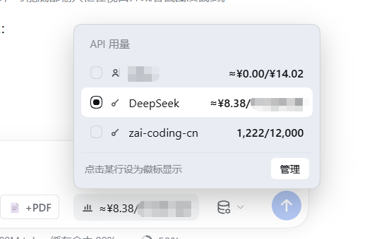
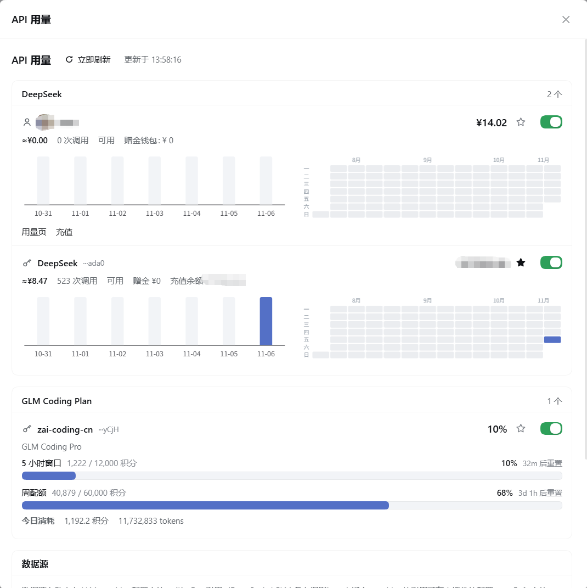

# dsh-api-usage

A DeepSeek Harness (dsh) plugin that shows a **DeepSeek balance / GLM Coding Plan quota** badge in the composer tool row, with per-key usage management and charts.

| Badge and source panel | Management dialog |
| :---: | :---: |
|  |  |

## Features

### Badge (composer tool row)

One compact badge showing the **currently selected source**:

```
📊 ≈¥9,999.99/¥9,999,999.00   ← DeepSeek: today's spend / balance
📊 888/12,000                 ← GLM: 5-hour window used / total
📊 53% used                   ← Codex: ChatGPT primary quota window
📊 Not selected               ← nothing to show
```

- Selection: manual choice > **signed-in DeepSeek account by default** > none
- Click the badge to refresh
- Hover for 300ms opens the **source panel** (fade-in), where clicking a row switches the badge subject; the "Manage" button in the corner opens the management dialog
- The choice is stored in the browser (instant switching) and synced to plugin config in the background

### Management dialog / Settings page (one shared UI)

- Settings → "API usage", or the "Manage" button in the badge panel (a `shell.overlay` dialog)

One card per source, all with the same structure:

```
★  🔑 DeepSeek  ···xxxx              ¥9,999,999.00   ☆  ●
   ≈¥9,999.99 · input 1,234,567 · output 89,012 · cache hits 234,567 · 888 calls · available · granted ¥0 · topped up ¥9,999,999.00
   [last 7 days bars]  [last 90 days calendar heatmap]
```

- **Card header**: star (badge subject), source icon/avatar, name, masked key tail, balance, visibility switch
- **Spend line**: today's spend, today's token usage (input / output / cache hits, split along the billing components), call count, availability, granted/topped-up balance
- **Charts**: ECharts dual-axis bar chart (7 days: CNY cost at 2 decimals + token usage, each on its own y-axis, with a legend) + GitHub-style calendar heatmap (90 days, week × weekday with month labels; toggle Cost/Tokens coloring, hover shows the day's CNY, tokens and call count)
- **GLM cards**: progress bars for the 5-hour / weekly / MCP quotas (percentage, reset countdown) plus today's official spend (credits/tokens)
- **Codex card**: primary and secondary ChatGPT subscription window utilisation, reset countdown and optional credits, read through the local Codex CLI sign-in; selectable as the badge subject
- Each source can be toggled independently

### API key management

- **Auto-discovery**: reads `apiKeyEnv` references from your LLM provider configuration
- **Manual keys**: "Add API key" stores additional DeepSeek / GLM keys in the DSH credential store (never in a config file)
- Each key has its own balance/quota, charts, and removal

## Data sources

| Vendor | Endpoint | Auth | Notes |
| --- | --- | --- | --- |
| DeepSeek | `GET https://api.deepseek.com/user/balance` | API key | official balance endpoint |
| DeepSeek account | Host `deepseekAccount` service | DSH session | profile and wallet balances |
| GLM Coding Plan | `GET {host}/api/monitor/usage/quota/limit` | Coding key | 5-hour / weekly / MCP quotas, plan level, reset times |
| GLM Coding Plan | `GET {host}/api/monitor/credit-usage/usage-detail` | Coding key | today's model spend (credits / tokens) |
| Codex subscription | local Codex app-server `account/rateLimits/read` | local Codex ChatGPT sign-in | used percentage and resets for quota windows |

The GLM host defaults to `https://open.bigmodel.cn`; set `glmBaseURL` to `https://api.z.ai` internationally.

**Link with `dsh-codex-subscription`**: when that plugin is installed and signed in, the Codex card reuses its reading over the page RPC `/codex-subscription` → `usage/accounts` (one row/card per signed-in account; the badge follows the account selected there) and labels the source; otherwise it falls back to the local Codex CLI probe.

Codex quota needs no pasted key: the plugin starts the local `codex app-server`, verifies `account/read` reports a `chatgpt` login, then reads the limits. OpenAI API-key billing and ChatGPT Codex subscription limits are separate products; only the latter is shown. Credentials, account IDs, e-mail addresses and raw upstream errors never reach the browser.

### DeepSeek today's spend (local metering)

DeepSeek exposes **no public usage API**, so the plugin listens to `llm/stream` on the Host and records every usage block per day; web-search requests are billed per request and counted too. Amounts are computed from the official rate card at read time:

```
usage chunk → { inputTokens (cache miss), cacheReadTokens (hit), outputTokens }
            → accumulated into peak / idle token buckets (priced on read)
            → split by provider route (account vs each API key)
            → persisted to $DSH_HOME/storages/api-usage/ledger.json (v2: token buckets)
```

- Covers **DSH's own calls only**; consumption by other clients on the same account is not included
- Built-in rate cards for `deepseek-flash` and `deepseek-v4-pro` (peak = idle × 2; peak is Beijing Mon–Fri 09:00–12:00 and 14:00–18:00; Chinese public holidays are not modelled yet)
- Web search: DSH searches through a DeepSeek Messages `web_search` server tool; the plugin counts `web/deepseek-search-llm-request` session events and estimates **CNY 5 / 1,000** requests. The search model's own tokens are not observable from the Harness and stay unmetered
- The ledger stores only token buckets; amounts are computed on read, so new data follows an official price change automatically (already-priced data migrated from v1 keeps its value)
- The last 400 days are kept by default (`retainDays`); the account route and each API-key route are metered **separately**

## Install

```bash
dsh plugin --profile desktop add github:Alfen2309/dsh-api-usage
```

Local development (linked install, edits take effect immediately):

```powershell
dsh plugin --profile desktop add "link:C:\MY\project\dsh-plugins\dsh-api-usage"
```

## Configuration

| Option | Default | Description |
| --- | --- | --- |
| `deepseekBaseURL` | `https://api.deepseek.com` | DeepSeek API base |
| `glmBaseURL` | `https://open.bigmodel.cn` | GLM API base (use `https://api.z.ai` internationally) |
| `codexCommand` | `""` | Optional path to the Codex CLI or its `codex.js`; empty discovers `@openai/codex` from the desktop profile, then falls back to `codex` on PATH |
| `pollSeconds` | `60` | refresh interval |
| `lowBalance` | `20` | low-balance threshold |
| `retainDays` | `400` | days of local ledger history kept (older days are pruned) |
| `selectedSource` | `""` | badge subject id (browser-local wins) |
| `hidden` | `[]` | sources excluded from badge aggregation |
| `extraRefs` | `[]` | extra credential references |

## Development

```bash
npm install          # echarts + esbuild
npm run build        # bundle client.js with inlined ECharts (no CDN)
npm run check        # syntax check
npm test             # Codex app-server protocol and sanitisation tests
```

- Source lives in `src/client.js`; `client.js` is the build output
- ECharts is registered on demand: `BarChart`, `HeatmapChart`, `CalendarComponent`, `VisualMapComponent`, `CanvasRenderer`
- Client changes require a **DSH application restart** to reload

## Security

- API keys are resolved and used only in the **Host process**; they never reach the browser
- The browser receives balances, quotas, usage and a 4-character key tail only; the Codex result carries plan type, quota windows and credits, never account data, tokens or raw errors
- Responses carry `Cache-Control: no-store`

## Known limitations

- DSH credential references are not enumerable: the plugin infers them from provider configuration, the `llm` directory and well-known names; use "Add API key" or `extraRefs` for the rest
- Providers pointing at the same `apiKeyEnv` are one key in DSH, so their balances match
- DeepSeek today's spend is a local estimate covering DSH calls only
- Metering starts when the plugin loads, so an install/restart day can read low; web search is estimated per request (its model tokens are unmetered); Chinese public holidays are not treated as off-peak
- GLM Coding Plan is a subscription; the plugin shows quota utilisation instead of a balance
- Codex requires a locally installed CLI signed in with ChatGPT; an API-key-only login has no subscription quota. A quota read starts one short-lived local app-server (12-second deadline) and concurrent requests share it.
- The DSH settings dialog cannot be opened programmatically by a plugin (no public API), so management uses the plugin's own dialog

## License

MIT
