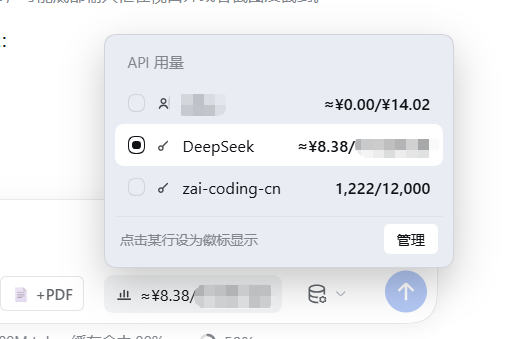
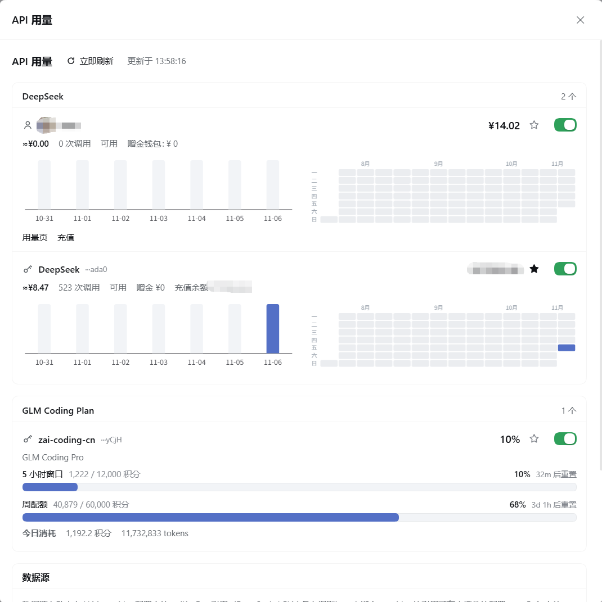

# dsh-api-usage

DeepSeek Harness（dsh）插件：在输入框工具行显示 **DeepSeek 余额 / GLM Coding Plan 配额**徽标，并提供逐 key 的用量管理与图表。

| 徽标与数据源面板 | 管理弹窗 |
| :---: | :---: |
|  |  |

## 功能

### 徽标（输入框工具行右侧）

一个紧凑徽标，显示**当前选中的数据源**：

```
📊 ≈¥6.85/¥77316.57        ← DeepSeek：今日消耗 / 余额
📊 1,222/12,000            ← GLM：5 小时窗口已用 / 总量
📊 未选中                   ← 没有可显示的数据源
```

- 选中逻辑：手动选中 > **默认 DeepSeek 登录账号** > 未选中
- 点击徽标 = 立即刷新
- 悬浮 300ms 打开**数据源面板**（带淡入动画），列出全部数据源，点击任意行即可切换徽标显示对象；右下角「管理」按钮打开管理弹窗
- 选中状态存浏览器本地（切换零延迟），并后台同步到插件配置

### 管理弹窗 / 设置页（同一份界面）

- 设置 →「API 用量」页
- 或点击徽标面板里的「管理」按钮（`shell.overlay` 弹窗）

每个数据源一张卡片，统一结构：

```
★  🔑 DeepSeek  ···ada0              ¥77316.57   ☆  ●
   ≈¥6.85 · 457 次调用 · 可用 · 赠金 ¥0 · 充值余额 ¥77316.57
   [近 7 天柱状图]  [近 90 天日历热力图]
```

- **卡片头部**：星星（设为徽标显示对象）、来源图标/头像、名称、key 尾号掩码、余额、显示开关
- **消耗行**：今日消耗、调用次数、可用状态、赠金/充值余额（合并一行）
- **图表**：ECharts 柱状图（近 7 天）+ 日历热力图（近 90 天，GitHub 贡献图风格，周×星期排列、月份标签）
- **GLM 卡片**：5 小时窗口 / 周配额 / MCP 工具额度的进度条（已用百分比、重置倒计时）+ 今日消耗（积分/tokens）
- 每个数据源可独立开关是否计入徽标聚合

### API key 管理

- **自动发现**：读取 LLM provider 配置里的 `apiKeyEnv` 引用，自动列出 DSH 中已配置的 key
- **手动添加**：管理页「添加 API key」可添加任意多个 DeepSeek / GLM key，存于 DSH 凭据库，不写入配置文件
- 每个 key 独立余额 / 配额、独立图表、独立删除

## 数据来源

| 供应商 | 接口 | 鉴权 | 说明 |
| --- | --- | --- | --- |
| DeepSeek | `GET https://api.deepseek.com/user/balance` | API key | 官方余额接口（总余额 / 赠金 / 充值余额） |
| DeepSeek 账号 | Host `deepseekAccount` 服务 | DSH 登录会话 | 已登录账号资料与钱包余额 |
| GLM Coding Plan | `GET {host}/api/monitor/usage/quota/limit` | Coding key | 5 小时 / 周 / MCP 额度、套餐等级、重置时间 |
| GLM Coding Plan | `GET {host}/api/monitor/credit-usage/usage-detail` | Coding key | 今日模型消耗（积分 / tokens） |

GLM host 默认 `https://open.bigmodel.cn`，国际站可在插件配置改成 `https://api.z.ai`。

### DeepSeek 今日消耗（本地记账）

DeepSeek **没有公开发用量接口**，插件在 Host 侧监听 `llm/stream`，把每次调用上报的 usage 按官方价目表计价，按天累计：

```
usage chunk → { inputTokens(缓存未命中), cacheReadTokens(命中), outputTokens }
            → 按 DeepSeek 官方 CNY 价目表计价（高峰/空闲两档）
            → 按 provider 渠道拆分（账号渠道 vs 各 API key 渠道）
            → 落盘 $DSH_HOME/storages/api-usage/ledger.json
```

- 只统计 **DSH 自身**的调用，其它客户端用同一账号的消耗不计入
- 价目表内置：`deepseek-flash`、`deepseek-v4-pro`（高峰期 = 空闲期 × 2，高峰为北京时间周一至周五 9:00–12:00、14:00–18:00）
- 账号渠道和每个 API key 渠道**分别计费**，互不混算

## 安装

从 GitHub 安装：

```bash
dsh plugin --profile desktop add github:Alfen2309/dsh-api-usage
```

本地开发调试（链接安装，改动即时生效）：

```powershell
dsh plugin --profile desktop add "link:C:\MY\project\dsh-plugins\dsh-api-usage"
```

## 配置

插件配置（设置 → 插件 → dsh-api-usage → 配置）：

| 配置项 | 默认值 | 说明 |
| --- | --- | --- |
| `deepseekBaseURL` | `https://api.deepseek.com` | DeepSeek API 基础地址 |
| `glmBaseURL` | `https://open.bigmodel.cn` | GLM API 基础地址（国际站用 `https://api.z.ai`） |
| `pollSeconds` | `60` | 自动刷新间隔（秒） |
| `lowBalance` | `20` | 低余额告警阈值（数字变色） |
| `selectedSource` | `""` | 徽标显示的数据源 id（浏览器本地优先） |
| `hidden` | `[]` | 不计入徽标聚合的数据源 |
| `extraRefs` | `[]` | 手动补充的凭据引用名 |

## 开发

```bash
npm install          # 安装 echarts / esbuild
npm run build        # 构建 client.js（ECharts 内联打包，无 CDN 依赖）
npm run check        # 语法检查
```

- 源码在 `src/client.js`，`client.js` 是构建产物（不要直接改）
- ECharts 按需注册：`BarChart`、`HeatmapChart`、`CalendarComponent`、`VisualMapComponent`、`CanvasRenderer`
- 客户端代码改动需要**重启 DSH 应用**才会重新加载

## 安全

- API key 只在 **Host 进程**内解析使用，**不会发送到浏览器**
- 前端只接收余额、配额、用量与 key 后 4 位掩码
- 所有接口响应带 `Cache-Control: no-store`

## 已知限制

- DSH 凭据引用不可枚举：插件从 provider 配置、`llm` 目录和常用引用名推断；未绑定的 key 请用「添加 API key」或 `extraRefs`
- 多个 provider 指向**同一个** `apiKeyEnv` 引用时，在 DSH 层面就是同一个 key，余额相同
- DeepSeek 今日消耗为本地估算，仅覆盖 DSH 调用；充值/跨客户端消耗不会反映
- GLM Coding Plan 是订阅制，没有"余额"概念，展示的是配额使用率与重置时间
- 设置弹窗无法从插件程序化打开（DSH 未暴露该 API），因此管理界面以插件自有弹窗呈现

## License

MIT
